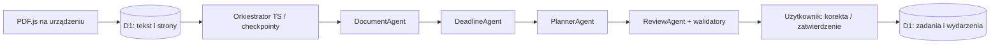

# StudentOS

Osobisty system studiów po polsku: React/PWA, Cloudflare Workers + D1 i czterej agenci Workers AI. Dane produkcyjne są prywatne; serwer dopuszcza wyłącznie skonfigurowane konto GitHub. Bez danych przykładowych na pulpicie i bez symulowanego AI w aplikacji.

**Stan:** implementacja i lokalna weryfikacja; wdrożenie, logowanie produkcyjne i prawdziwy model wymagają konfiguracji konta Cloudflare oraz GitHub OAuth. Nie uznajemy ich za sprawdzone. Szczegółowe wyniki: [raport testów](docs/TEST_REPORT.md).

## Uruchomienie lokalne

Wymagany Node.js 24 i npm. W dwóch terminalach:

```sh
npm ci
cp .dev.vars.example .dev.vars
npm run db:local
npm run build
npm run worker:dev
```

```sh
npm run dev
```

Otwórz `http://localhost:5173`. `DEV_AUTH=true` działa wyłącznie dla adresów loopback i jest trybem deweloperskim, nie logowaniem produkcyjnym. Prywatne API wymaga połączenia; PWA nie przechowuje danych akademickich w cache offline. Lokalna analiza PDF działa bez konta; lokalne wywołanie Workers AI wymaga poprawnie autoryzowanego bindingu i nie jest zastępowane atrapą.

## Sprawdzenie

```sh
npm run lint
npm run format:check
npm test
npm run build
npm run db:local
npx playwright install --with-deps chromium
npm run test:e2e
npx wrangler deploy --dry-run --outdir /tmp/studentos-worker
```

Testy integracyjne używają rzeczywistego lokalnego D1 (Miniflare). Testy orkiestratora mają jawnie kontrolowane odpowiedzi AI i **nie dowodzą jakości prawdziwego modelu**. PDF-y i referencyjne terminy są w `tests/fixtures/`; generator: `node tests/fixtures/generate.mjs`. Konfiguracja Playwright wybiera dostępną przeglądarkę systemową lub zainstalowaną przez Playwright.

## Wdrożenie za 0 PLN

[Konfiguracja z telefonu](docs/DEPLOYMENT.md) oraz [szczegóły autoryzacji](docs/DEPLOYMENT_AUTH.md).

Workflow `Deploy StudentOS (Workers Free)` tworzy lub wykorzystuje D1 `studentos`, zapisuje migracje, publikuje Worker/Static Assets, przekazuje sekrety przez stdin oraz sprawdza `/api/health` i brak anonimowego dostępu. Workflow wymaga potwierdzenia używania **Workers Free**. Kod nigdy nie aktywuje planu Paid, domeny, płatnego API ani kredytów AI Gateway.

Darmowe limity dostawcy są współdzielone przez aplikacje na koncie. Po ich wykorzystaniu część operacji może być niedostępna do resetu; nie obiecujemy nieograniczonego darmowego hostingu. Koszty i źródła: [Cloudflare research](docs/CLOUDFLARE_RESEARCH.md).

## System agentów



Każdy agent ma własny prompt, schemat wejścia/wyjścia i walidację. Jedno żądanie wykonuje jeden etap lub fragment; wznowienie jest jawne i nie zależy od procesu działającego w tle. Logi zawierają operacyjne metadane, ustrukturyzowane wyniki i walidację, bez ukrytego rozumowania modelu.

Budżety: 10 MB PDF, 100 stron, 120 000 znaków tekstu; fragmenty do 30 000 znaków; 2 analizy i 24 wywołania modelu dziennie, 12 wywołań na przebieg, maksymalnie jedna ponowna próba. Pełne szczegóły i aktualne ograniczenia: [orkiestracja](docs/ORCHESTRATION.md).

PDF pozostaje na urządzeniu. Do D1 trafiają wyodrębniony tekst, numery stron, metadane i wyniki. Tekst przekazywany do Workers AI jest niezaufanym materiałem; agenci nie mają uprawnień do sieci ani zapisu bazy. Zadania i wydarzenia zapisuje dopiero jawne zatwierdzenie użytkownika.

## PWA na Androidzie

Po wdrożeniu otwórz adres aplikacji w Chrome, zaloguj się przez GitHub, wybierz menu `⋮` → **Dodaj do ekranu głównego** → **Zainstaluj**. Instalacja wymaga HTTPS; tryb offline pokazuje komunikat bez udawania dostępu do danych w chmurze.

## Dokumentacja akademicka

- [Architektura](docs/ARCHITECTURE.md), [decyzje](docs/DECISIONS.md), [backlog](docs/BACKLOG.md)
- [Agenci developmentu i runtime](docs/AGENTS.md), [orkiestracja](docs/ORCHESTRATION.md)
- [Rzeczywisty dziennik prac](docs/DEVELOPMENT_LOG.md), [raport testów](docs/TEST_REPORT.md)
- [Prezentacja 15 min, diagramy, demo i pytania](docs/PRESENTATION.md)

## Bezpieczna kontynuacja

Sekrety należą do GitHub Actions Secrets lub Cloudflare Worker Secrets. Nie zapisuj ich w repozytorium ani czacie. `.dev.vars`, `.env*` i wygenerowany `wrangler.production.json` są ignorowane. Każdy kolejny etap należy rozpocząć od raportu testów, backlogu i dziennika prac; niewykonanych testów chmurowych nie wolno oznaczać jako zakończone.
