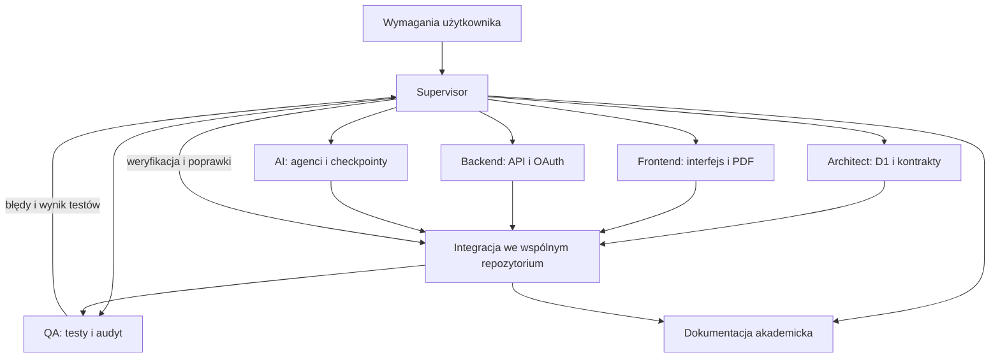

# Agenci StudentOS

Projekt wykorzystuje dwa odrębne systemy delegowania: rzeczywistych agentów pomocniczych podczas developmentu oraz cztery role agentowe wywołujące model wewnątrz aplikacji. Agent tworzący kod nie jest agentem uruchamianym później przy analizie PDF.

## Zespół developmentu

Podział został rzeczywiście zlecony w tej sesji przez Supervisora. Agenci mają wspólny workspace i rozłączne obszary odpowiedzialności. Komunikują się narzędziami delegowania i wiadomościami; integracja kodu odbywa się przez wspólne pliki. Nie jest to symulacja czterech person w jednej odpowiedzi.

| Rola                | Zlecenie                                                  | Obszar kodu i rezultat                                                                                |
| ------------------- | --------------------------------------------------------- | ----------------------------------------------------------------------------------------------------- |
| Supervisor          | Narzędzia, fundament, integracja, konfiguracja publikacji | Konfiguracja projektu, zależności, łączenie modułów i sprawdzanie blokad wdrożenia                    |
| Architect Agent     | Architektura, schemat D1, kontrakty i decyzje             | `shared/`, `migrations/`, dokumentacja architektury i decyzji                                         |
| Frontend Agent      | Mobilny interfejs i przepływy użytkownika                 | `src/`, nawigacja, ekrany, import PDF, PWA                                                            |
| Backend Agent       | API, autoryzacja, własność danych i CRUD                  | `worker/`, endpointy i sesje                                                                          |
| AI Agent            | Cztery role runtime, walidacja i orkiestrator             | `worker/agents.ts`, `worker/orchestrator.ts`                                                          |
| QA Agent            | Scenariusze, fixture PDF i testy                          | `tests/`, E2E oraz `docs/TEST_REPORT.md`                                                              |
| Documentation Agent | Zgodna ze stanem kodu dokumentacja procesu i prezentacja  | Niniejszy plik, `ORCHESTRATION.md`, `DEVELOPMENT_LOG.md`, `PRESENTATION.md`, `CLOUDFLARE_RESEARCH.md` |

Wyniki, błędy integracji i ograniczenia odnotowujemy w [DEVELOPMENT_LOG.md](DEVELOPMENT_LOG.md). O zaliczeniu testu decyduje wykonanie narzędzia, a nie deklaracja agenta. Supervisor rozstrzyga niezgodności kontraktów i nie łączy niezweryfikowanych rezultatów jako zakończonej funkcji.

## Agenci działający w aplikacji

Definicje promptów i walidatory znajdują się w `worker/agents.ts`; schematy wejścia i wyjścia są współdzielone przez `shared/contracts.ts`. Wywołanie jednej roli zawiera jej własny system prompt oraz osobne dane wejściowe. Model nie otrzymuje bindingu D1, sesji ani narzędzi sieciowych. Dostęp do danych i operacje zapisu wykonuje kontrolowany kod serwera. Wspólny model nie oznacza wspólnej odpowiedzialności.

| Agent         | Wejście                                                                       | Wyjście                                                           | Niezależna kontrola                                                                 |
| ------------- | ----------------------------------------------------------------------------- | ----------------------------------------------------------------- | ----------------------------------------------------------------------------------- |
| DocumentAgent | Nazwa, tekst stron, kontekst dokumentu                                        | Struktura, typ dokumentu, sekcje i cytaty z numerami stron        | Schemat Zod i sprawdzenie, czy cytat istnieje na wskazanej stronie                  |
| DeadlineAgent | Dokument, fragmenty źródeł, istniejące zadania i kontekst dat                 | Obowiązki, źródła, data lub `null`, pewność i wymóg potwierdzenia | Poprawność daty kalendarzowej, pełna data w dowodzie, deduplikacja                  |
| PlannerAgent  | Obowiązki, dostępność i zajęte terminy                                        | Edytowalne szacunkowe bloki nauki                                 | Kolejność początku i końca, termin zadania, brak kolizji; szacunki zawsze oznaczone |
| ReviewAgent   | Zweryfikowane cytaty, pierwsza struktura dokumentowa i wyniki pozostałych ról | Decyzje dla propozycji i problemy                                 | Osobny walidator deterministyczny nie ufa samemu `accepted` zwróconemu przez LLM    |

DocumentAgent i DeadlineAgent otrzymują katalog dosłownych fragmentów zamiast duplikowanych stron tekstu. Wskazują `{ref_id}`, a serwer odtwarza dokładną stronę i cytat; nieznana referencja jest błędem. Publiczny kontrakt aplikacji nadal zawiera `{page, quote}`.

Kontrakt wyjściowy zawiera wyniki i krótkie operacyjne uzasadnienia. Nie wymaga ani nie zapisuje ukrytego toku rozumowania. Źródła pozostają niezaufanymi danymi; prompt jawnie zabrania wykonywania instrukcji z PDF. To zmniejsza ryzyko prompt injection, lecz nie daje matematycznej gwarancji poprawności LLM. Dlatego wynik musi przejść schemat, kontrolę źródeł i zatwierdzenie człowieka.

Daty niepełne pozostają puste i wymagają potwierdzenia. Rok akademicki nie uprawnia do dopisania roku, którego nie ma w materiale. Review może odrzucić wynik innego modelu. Niezależny walidator ma dostęp do pełnego tekstu; model ReviewAgent otrzymuje tylko wybrane cytaty, co ogranicza jego kontekst dla długiego dokumentu. Nie zapisujemy propozycji jako zadania, zanim użytkownik nie zatwierdzi wyniku.

## Obserwowalność i uczciwość demonstracji

Log zawiera identyfikator uruchomienia, nazwę roli, czas, status, liczbę prób, model, operacyjne podsumowania oraz ustrukturyzowany wynik. `usage` prezentujemy jedynie, gdy dostawca rzeczywiście je zwrócił. Test z podstawionym bindingiem AI jest testem integracji, nie rzeczywistym wywołaniem modelu. Rzeczywiste przebiegi GLM ze zdalnym D1 zapisano w `docs/evidence/`. Izolowane dane fixture zostały posprzątane, więc nie muszą pozostać widoczne na prywatnym pulpicie. Test bindingów na loopback i odbiór produkcyjnego HTTP są rozdzielone w raporcie.
