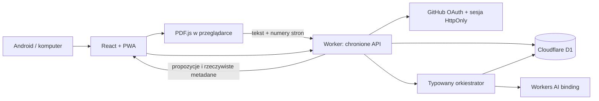
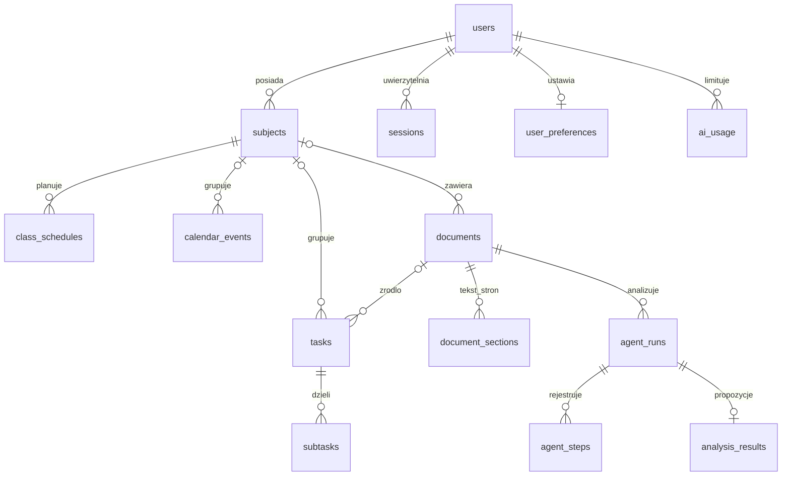
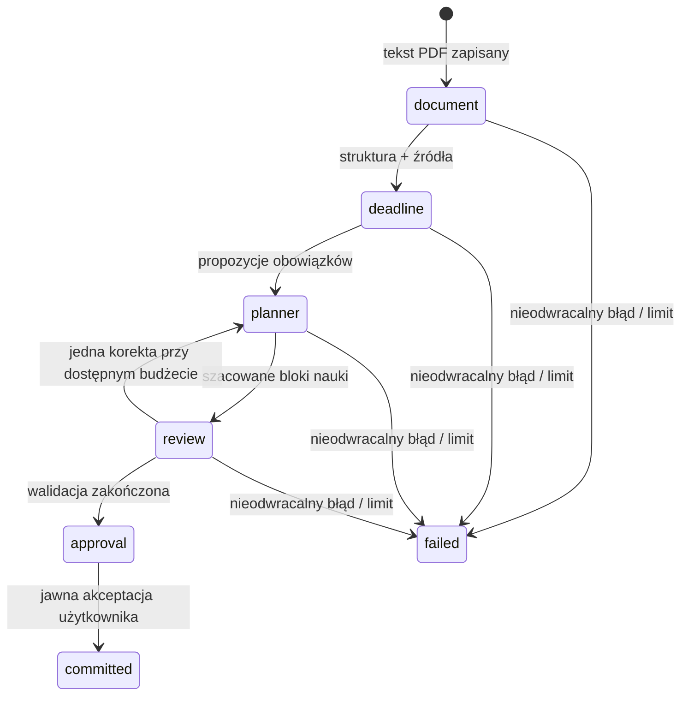

# Architektura StudentOS

Stan: architektura wersji 0.1, 15.10.2026. Dokument opisuje kontrakty i kod w repozytorium; nie stanowi potwierdzenia wdrożenia ani wykonania zdalnego modelu. Wyniki weryfikacji znajdują się w `TEST_REPORT.md`.

## Granice systemu

StudentOS jest aplikacją React/TypeScript uruchamianą jako zasoby statyczne Cloudflare Workers. Worker obsługuje API, uwierzytelnianie GitHub OAuth, zapis w D1 i wywołania Workers AI przez binding `AI`. Wspólnym źródłem kontraktów jest `shared/contracts.ts`, migracją początkową `migrations/0001_initial.sql`.

Oryginalny PDF pozostaje na urządzeniu. Chmura przechowuje wydobyty tekst, nazwę, hash, numery stron, wyniki analizy i historię wykonania. Po zmianie urządzenia dostępne są tekst i cytaty, ale nie oryginalny plik. Skan bez warstwy tekstowej wymaga osobnego OCR, którego ta wersja nie zapewnia.

## Kontrakty API

Wszystkie prywatne operacje wymagają sesji zweryfikowanej na serwerze. Dane wejściowe korzystają z `snake_case`; `user_id` i identyfikatory nowych rekordów ustala serwer. Daty bez czasu: `YYYY-MM-DD`; interfejs wyświetla `DD.MM.RRRR`. Instancje czasu: ISO 8601 z offsetem. Cykliczny plan przechowuje lokalne `HH:mm`, dzień ISO 1–7 i zakres obowiązywania w Europe/Warsaw.

| Endpoint                                      | Kontrakt                                                           |
| --------------------------------------------- | ------------------------------------------------------------------ |
| `GET /api/bootstrap`                          | Użytkownik, kolekcje, preferencje i podzadania do inicjalizacji UI |
| `GET /api/{subjects,tasks,events,schedules}`  | `{ items: [...] }` tylko właściciela                               |
| `POST /api/{subjects,tasks,events,schedules}` | Walidowany input → nowy rekord, HTTP 201                           |
| `GET /api/{kolekcja}/:id`                     | Pojedynczy rekord właściciela                                      |
| `PATCH /api/{kolekcja}/:id`                   | Częściowy input → zaktualizowany rekord                            |
| `DELETE /api/{kolekcja}/:id`                  | `{ ok: true }`                                                     |
| `/api/tasks/:id/subtasks[/:subId]`            | GET listy, POST, PATCH i DELETE podzadań                           |
| `GET/PUT /api/preferences`                    | Wspólny schemat preferencji                                        |
| `GET /api/export`                             | Prywatny eksport JSON, bez sekretów i tokenów                      |
| `GET /api/export.ics`                         | Kalendarz ICS wydarzeń i powtarzalnych zajęć                       |
| `DELETE /api/data`                            | Usunięcie danych akademickich właściciela                          |

Błędy: `{ error: { code, message, details? } }`. Nieistniejący i cudzy rekord dają ten sam HTTP 404. Dokumenty i uruchomienia mają osobne endpointy opisane w `ORCHESTRATION.md`; nie są zwykłym CRUD-em, ponieważ muszą zachowywać limity i przejścia maszyny stanów.

## Model danych

Każda tabela prywatnych danych ma `user_id`. Klucze obce wymuszają usunięcia kaskadowe lub `SET NULL`. Triggery blokują przypięcie zadań, wydarzeń i zajęć do cudzych przedmiotów, a także powiązanie dokumentów i wyników z cudzymi rekordami. API dodatkowo sprawdza właściciela przed odczytem i zapisem. Indeksy obejmują właściciela i terminy, historię uruchomień, strony oraz klucze cache. Unikalny `(user_id,hash)` zapobiega podwójnemu zapisowi tego samego PDF; `(user_id,document_id,proposal_id)` chroni zatwierdzanie przed powieleniem.

`analysis_results` zawiera propozycje przed zatwierdzeniem. Tabele `tasks` i `calendar_events` przechowują zatwierdzone dane. `agent_runs.context_json` to checkpoint, `agent_steps` to operacyjne logi. Elastyczne wyniki agentów mają walidowane JSON-y, natomiast encje akademickie są znormalizowane. Preferencje mają wersjonowalny JSON walidowany Zod przy zapisie i odczycie.

## Przepływ agentowy

Każdy etap zapisuje checkpoint i jest wywoływany osobnym żądaniem. Odświeżenie albo utrata połączenia zatrzymuje postęp do następnego żądania klienta; nie kasuje zapisanych etapów. Nie ma założenia, że długa analiza zmieści się w pojedynczym żądaniu lub będzie wykonywana w niezawodnym tle. Lease zabezpiecza przed równoczesnym wykonaniem tego samego etapu z kilku kart. Częściowy indeks UNIQUE z migracji `0002_one_active_run.sql` atomowo dopuszcza tylko jedno aktywne wykonanie na dokument i właściciela. Przegrany wyścig tworzenia uruchomienia zwraca istniejące wykonanie. Migracja zachowuje historię ewentualnych wcześniejszych duplikatów, oznaczając nadmiarowe wykonania jako nieudane i pozostawiając najbardziej zaawansowane.

W tej wersji ReviewAgent może zlecić jeden powrót do PlannerAgent, jeśli pozostał budżet dwóch wywołań na poprawkę i ponowną weryfikację. Nie ma automatycznej pętli poprawiania ekstrakcji dat; problemy pozostają w raporcie i wymagają kontroli użytkownika.

Każdy z czterech agentów ma własny prompt i schemat wejścia/wyjścia. Nie otrzymują narzędzia dowolnego SQL, sieci, plików ani zapisu zadań. Orkiestrator sam wykonuje dozwolone operacje. Odpowiedź modelu przechodzi walidację struktury oraz deterministyczną kontrolę źródeł i dat. ReviewAgent otrzymuje materiały do niezależnej kontroli; sama deklaracja modelu nie stanowi dowodu poprawności.

## Bezpieczeństwo i koszty

Przeglądarka nie przechowuje tokenu GitHub. Serwer używa losowej sesji w cookie HttpOnly; D1 przechowuje wyłącznie jej hash. OAuth wymaga jednorazowego state i powiązania z przeglądarką. Zapis sprawdza Origin i format JSON; CSP ogranicza skrypty i połączenia do aplikacji. Nie wolno włączać `DEV_AUTH` na domenie produkcyjnej. Wariant osobisty ogranicza logowanie do skonfigurowanego identyfikatora konta GitHub.

Limity aplikacji są odrębne od limitów dostawcy: PDF do 100 stron, do 30 000 znaków na stronę i do 120 000 znaków łącznie; pozostałe limity wywołań, prób, wejścia i wyjścia AI definiuje orkiestrator. `ai_usage` zlicza rezerwacje analiz i wywołań na dzień. Metryki tokenów zapisuje się tylko wtedy, gdy zwraca je provider. Brak metryk nie jest zerowym zużyciem. Liczba tokenów ani wywołań nie jest dokładnym kosztem w PLN lub odczytem neuronów Cloudflare.

Treść PDF jest niezaufanym materiałem źródłowym. Instrukcje w tekście nie zmieniają promptów systemowych ani uprawnień. Wyczerpanie limitu blokuje analizę AI, pozostawiając ręczne operacje akademickie dostępne. Darmowy plan należy utrzymać bez aktywowania płatnych nadwyżek; samo ustawienie limitów aplikacji nie zastępuje ustawień rozliczeń konta Cloudflare.

## Granice wdrożenia

Repozytorium nie dostarcza konta Cloudflare, autoryzacji, bazy zdalnej ani aplikacji GitHub OAuth. Ich utworzenie wymaga działań właściciela. Binding `AI` i działanie konkretnego modelu trzeba sprawdzić na koncie docelowym. Lokalny test z kontrolowaną odpowiedzią nie potwierdza jakości zdalnego LLM. Dane testowe nie są produkcyjnymi danymi dashboardu.
