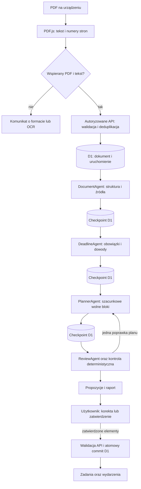
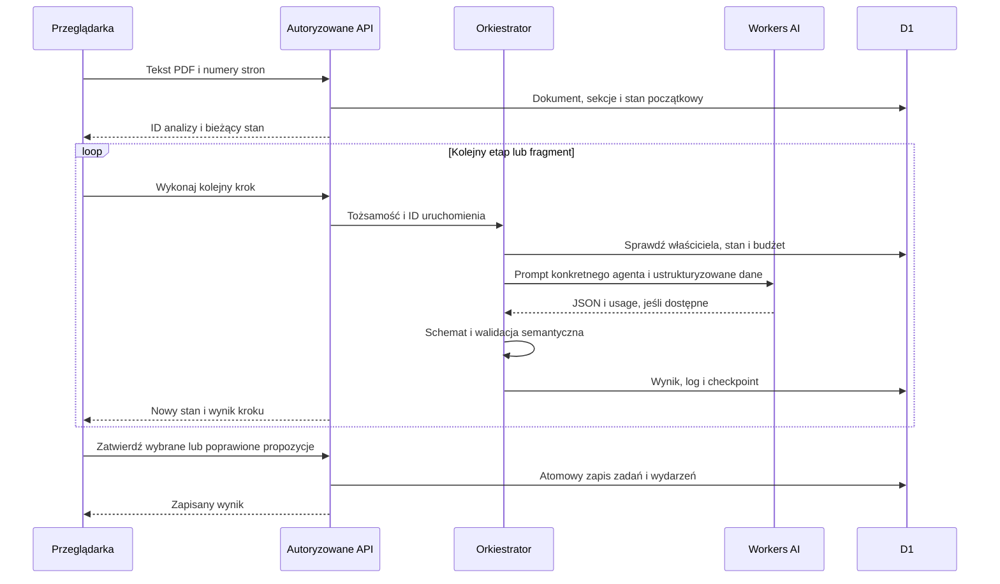

# Orkiestracja analizy dokumentu

## Cel i granice odpowiedzialności

Orkiestrator TypeScript steruje zbiorem jawnych stanów. Nie przekazuje LLM uprawnienia do wykonania SQL ani automatycznego tworzenia zadań. Każda rola produkuje typowany wynik, który jest odrębnie weryfikowany. Baza D1 przechowuje checkpointy i historię, a klient pobudza kolejne etapy przez żądania HTTP.

PDF.js odczytuje tekst w przeglądarce. Oryginalny PDF nie jest wysyłany do Cloudflare; przekazywane są tekst, numery stron, hash i metadane. Skan bez warstwy tekstowej kończy się komunikatem o potrzebie OCR. Wyniku analizy takiego skanu nie wymyślamy. PDF nie będzie dostępny na drugim urządzeniu, jeżeli użytkownik nie posiada tam pliku; tekst i wyniki pozostają w D1.

Strzałka poprawki nie oznacza pętli bez końca: liczba prób i wywołań jest limitowana. Konkretne przejścia i budżety są egzekwowane w `worker/orchestrator.ts`, a nie przez deklarację w promptach. Dla dłuższego dokumentu DocumentAgent i DeadlineAgent obsługują do czterech bazowych fragmentów po 30 000 znaków, uzupełnionych o kontekst sąsiadów do 800 znaków z każdej strony. Podział pozostaje znakowy z zachowaniem numerów stron, nie semantyczny; zdanie na granicy fragmentu może utrudnić ekstrakcję. Ekran pokazuje rzeczywiste kroki, a nie cztery odliczane animacje.

## Dlaczego wiele żądań HTTP

Workers Free ma krótki budżet CPU. Parsowanie całego PDF, cztery wywołania modelu i walidacja dużego dokumentu nie są traktowane jako jedna gwarantowana operacja w tle. Każde wywołanie API wykonuje ograniczony etap i utrwala rezultat. Po odświeżeniu klient odczytuje zapisany stan i może wywołać następny etap. Zamknięta przeglądarka nie oznacza, że workflow nadal działa: nie polegamy na niegwarantowanych zadaniach background.

Checkpoint jest punktem kontynuacji, nie gwarancją dokładnie jednego obciążenia dostawcy. Jeśli model odpowie, lecz połączenie przerwie się przed zapisem, ponowienie może wymagać kolejnego wywołania. Dlatego każda próba konsumuje budżet, a równoległe uruchomienie tego samego kroku musi być blokowane.

## Budżety egzekwowane w kodzie

| Zasób                            | Limit                                                                                     |
| -------------------------------- | ----------------------------------------------------------------------------------------- |
| PDF w przeglądarce               | 10 MB, 100 stron, 120 000 znaków tekstu                                                   |
| Strona przy uploadzie            | 30 000 znaków                                                                             |
| Bazowy fragment analizy          | 30 000 znaków, najwyżej 4 fragmenty                                                       |
| Dane wejściowe pojedynczego LLM  | 64 000 znaków serializowanego JSON; to limit znaków, nie tokenów                          |
| Odpowiedź modelu                 | 1500 tokenów; GLM: `max_completion_tokens`, Gemma: `max_tokens`                           |
| Uruchomienie                     | 12 wywołań modelu, w tym najwyżej 1 ponowienie po błędzie w całym run                     |
| Poprawka z ReviewAgent           | Najwyżej 1 powrót do PlannerAgent, potem ReviewAgent; wymagany pozostały budżet 2 wywołań |
| Użytkownik i dzień Europe/Warsaw | 4 nowe analizy, 24 wywołania AI                                                           |
| Konkurencja kroków               | Lease D1 na 5 minut; kolejny klient otrzymuje konflikt zamiast równoległego wywołania     |
| Propozycje łącznie               | 40; nadmiar wymaga podziału dokumentu                                                     |

Jeden dokument z czterema fragmentami potrzebuje bazowo 10 wywołań: 4 dokumentowe, 4 terminowe, planowanie i przegląd. Retry oraz poprawka współdzielą budżet 12, więc nie każda kombinacja jest wykonywalna. Limity analiz i wywołań są rezerwowane atomowo w D1 przed kosztowną operacją. Nie stanowią dokładnego pomiaru neurons.

## Stany, cache i błąd

`POST /api/documents` utrwala tekst. `POST /api/documents/:id/analyze` tworzy wykonanie lub zwraca już istniejące. `POST /api/runs/:id/advance` wykonuje najwyżej jedno wywołanie modelu. `GET /api/runs/:id` odczytuje checkpoint i logi. `POST /api/runs/:id/approve` zatwierdza wybrane propozycje.

Ścieżka stanów: `document → deadline → planner → review → approval → committed`. Stany `document` i `deadline` powtarzają się dla fragmentów. Poprawka może wrócić wyłącznie z `review` do `planner`, jeden raz. Zły JSON lub niespełniony kontrakt może spowodować pojedynczą powtórkę tego samego etapu. Trwały błąd, wyczerpanie retry lub limitu przechodzi do terminalnego `failed`; zapisane checkpointy pozostają widoczne, ale nie istnieje API odblokowujące to samo zakończone błędem uruchomienie. Ponowna analiza jest nowym run i zużywa nową rezerwację.

Hash tekstu stron jest przeliczany po stronie serwera. Cache ma zakres właściciela, modelu, wersji workflow i roku akademickiego oraz snapshotu aktualnych zadań, wydarzeń, zajęć i preferencji. Aktywne wykonanie oraz wcześniej zatwierdzony wynik są ponownie używane przez wskazanie prawdziwego run; nie powstają fikcyjne kroki „z cache”. Aktywny run jest domyślnie ponownie używany. `?force=1` przy zleceniu analizy jawnie kończy niepracujące aktywne wykonanie i tworzy nowe, zużywając budżet; wykonujący się krok jest chroniony lease. Cache nie daje automatycznego przeliczenia harmonogramu po zmianie zajęć. Aktualne konflikty są ponownie sprawdzane przy zatwierdzaniu.

## Przekazanie danych

## Walidacja i bezpieczeństwo

- Zod sprawdza format wejścia i wyjścia każdego etapu. Niepoprawny JSON jest błędem, nie wynikiem analizy.
- Cytat musi wystąpić na wskazanej stronie. Dla konkretnej daty wymagany jest dowód pełnego dnia, miesiąca i roku.
- Deduplikacja dokumentów korzysta z hasha w obrębie właściciela; propozycje są porównywane z istniejącymi zadaniami.
- ReviewAgent dostaje zweryfikowane cytaty oraz pierwszą strukturę dokumentową; niezależna kontrola deterministyczna sprawdza pełny tekst. To ograniczenie kontekstu modelowego przy wielu fragmentach.
- Planner zwraca tylko szacunki; kontrola serwera odrzuca bloki kolidujące z zajętymi terminami.
- Treść PDF jest danymi niezaufanymi. Agenci nie mają narzędzi, sekretów ani dostępu do sieci i D1.
- Błędy limitu AI nie usuwają dokumentu ani zapisanych zadań. Zarządzanie przedmiotami i zadaniami nie wymaga dostępnego modelu.
- Zatwierdzenie w UI nie pomija serwerowej walidacji właściciela i danych. Jeżeli użytkownik ręcznie doda datę niepotwierdzoną w cytacie, zadanie zapisuje `date_origin: user_confirmed` z ostrzeżeniem. Data nie staje się przez to faktem wydobytym z dokumentu.

## Katalog źródeł i zachowawczy przegląd

Przed wywołaniem DocumentAgent i DeadlineAgent serwer tworzy katalog dosłownych fragmentów z identyfikatorami. Transport zawiera `evidence_catalog` zamiast powielonego `pages`; model wybiera `{ref_id}`, a serwer odtwarza dokładne `{page, quote}`. Katalog zachowuje tekst i numery stron, dzieląc go według zdań/linii oraz limitu 800 znaków na wpis. Nieznane referencje są odrzucane. Dotychczasowy format cytatu nadal przechodzi walidację; nie ma zgody na dowolnie przepisany tekst.

ReviewAgent może zwrócić niepełne lub błędne ID. Serwer zachowuje oryginalny wynik i osobne metadane uzgodnienia. Nieznane ID są pomijane, a pozycje pominięte, powtórzone lub sprzeczne nie uzyskują automatycznej akceptacji. Akceptację dodatkowo ogranicza niezależna kontrola źródeł i dat. Cache ma wersję v2. Log rozróżnia liczbę bloków zaproponowanych, zatrzymanych po filtrach i zatwierdzonych.

## Zmiana zatwierdzonego terminu

Migracja `0003_task_calendar_links.sql` wiąże wygenerowane wydarzenia z zadaniem przez `task_id`. Edycja terminu zadania aktualizuje jego dzienne wydarzenie, usuwa poprzednie powiązane bloki nauki i oznacza `planning_status: needs_replanning`; nie wywołuje automatycznie modelu. Ręczna zmiana daty zachowuje źródła i ustawia pochodzenie `user_confirmed`. Usunięcie zadania usuwa powiązane wydarzenia przez klucz obcy. Aktualizacja zadania i kalendarza jest atomowa z kontrolą wersji `updated_at`.

## Limity zapytań D1 Free

Wiele wierszy zapisujemy w jednym parametryzowanym INSERT. Strony są grupowane po 20 wierszy (5 kolumn = 100 parametrów), a zadania zatwierdzenia po 9 wierszy przy 99 parametrach wraz z warunkiem lease, a wydarzenia z `task_id` po 8 wierszy przy 96 parametrach. `DB.batch()` nadal zapewnia atomowość grupy poleceń; samo batch nie omija limitu 50 zapytań na wywołanie Workera. Migracja `0002_one_active_run.sql` dodaje częściowy indeks UNIQUE dla jednego aktywnego run na dokument i właściciela.

## Logi operacyjne

`agent_runs` opisuje całe wykonanie, a `agent_steps` poszczególne próby/etapy. Logi nie stanowią zapisu ukrytego rozumowania. Ich źródłem jest kod wokół rzeczywistego wywołania modelu i walidatora. W testach podstawiony binding jest jawnie oznaczoną zależnością testową.

Podczas prezentacji należy otworzyć **Agent Activity** dla nowej analizy lub rzeczywisty dowód z `docs/evidence/`. Pokazujemy ID, model, statusy, czasy, źródła i wyniki filtrów. Dane fixture po testach usunięto; brak ich w prywatnym UI nie oznacza braku wykonanego testu. Wcześniejsze błędy walidacji również są częścią raportu, a nie historią zastąpioną późniejszym sukcesem.

## Kontynuacja po wdrożeniu

1. Zaloguj właściciela przez GitHub OAuth.
2. Zaimportuj tekstowy PDF z fixture testową i uruchom analizę.
3. Obserwuj pierwszy etap, odśwież stronę i wznow kolejny krok z checkpointu.
4. Otwórz logi tego samego uruchomienia na drugim urządzeniu.
5. Przejrzyj raport ReviewAgent, popraw niepełny termin i zatwierdź wybrane elementy.
6. Sprawdź zapis po ponownym logowaniu oraz brak duplikatu po ponownym imporcie.

Wynik tych czynności należy wpisać do `TEST_REPORT.md` dopiero po ich wykonaniu. Status autoryzacji i publikacji opisują `DEPLOYMENT.md`, `DEPLOYMENT_AUTH.md` i README. Stan kryteriów odbioru: `ACCEPTANCE.md`.
