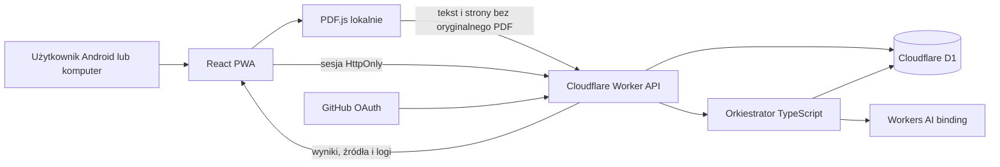
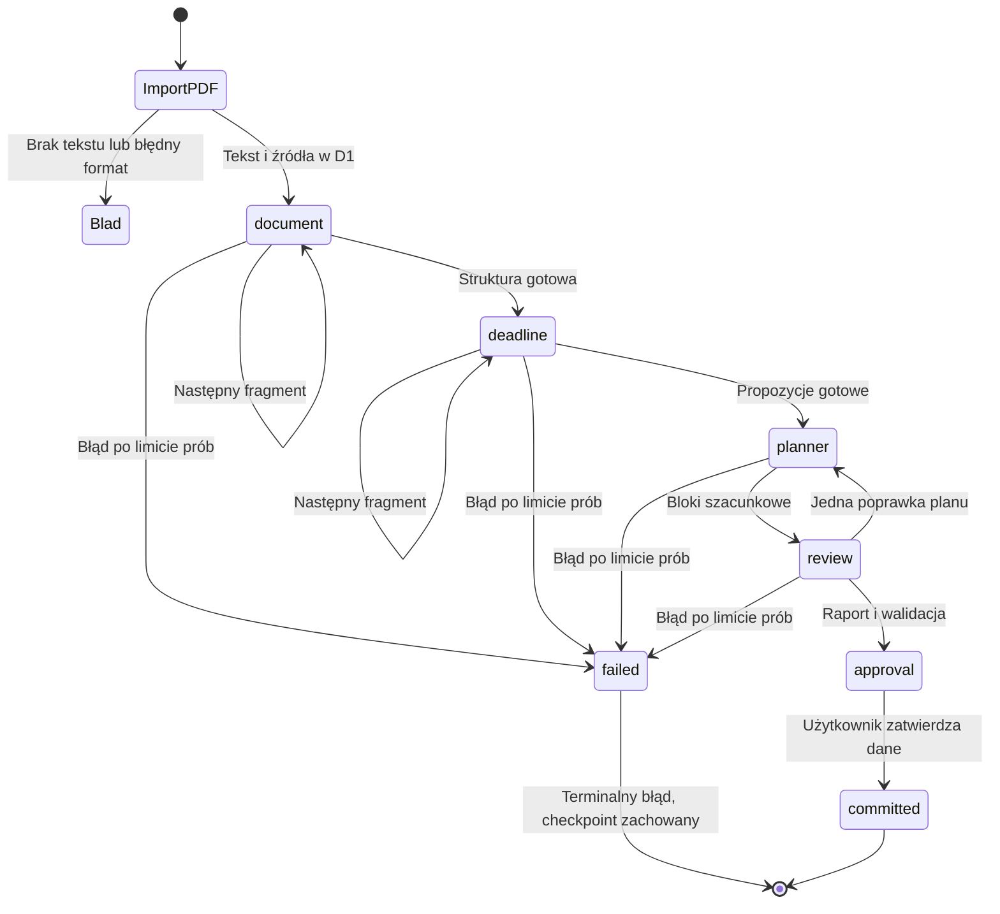
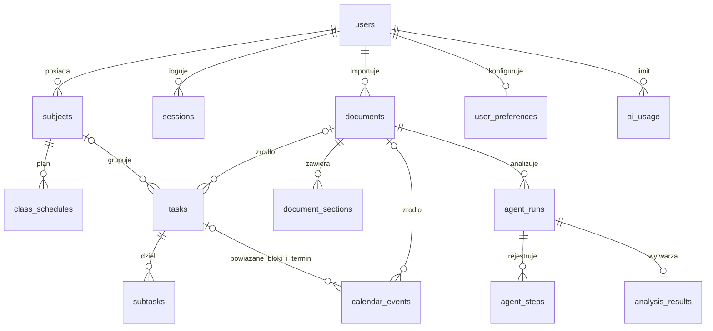
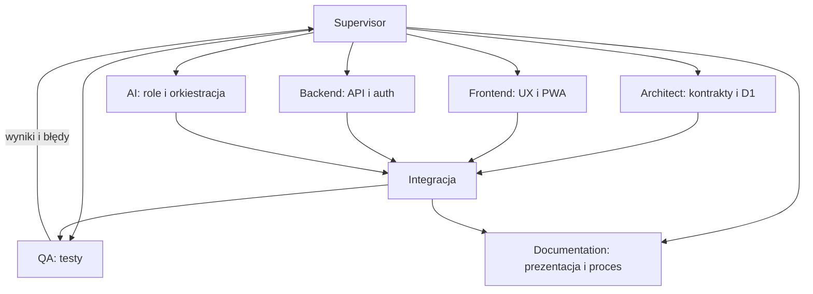

# StudentOS — prezentacja na 15 minut

**Temat:** osobisty system zarządzania studiami z kontrolowaną analizą PDF przez czterech agentów AI.

**Stan odbioru:** [ACCEPTANCE.md](ACCEPTANCE.md) mapuje kryteria użytkownika na implementację, lokalne dowody i blokady produkcyjne.

**Zasada prezentacji:** oddzielamy kod zaimplementowany, testy wykonane lokalnie, testy z podstawionym modelem oraz zweryfikowane działanie produkcyjne. Źródłem bieżących wyników jest [TEST_REPORT.md](TEST_REPORT.md). Publikacja, OAuth i prawdziwe Workers AI wymagają konfiguracji kont; ten dokument sam nie potwierdza ich działania.

## Plan wystąpienia

| Czas        | Slajd / pokaz              | Najważniejsza wypowiedź                                                                                                                    |
| ----------- | -------------------------- | ------------------------------------------------------------------------------------------------------------------------------------------ |
| 0:00–0:50   | Problem                    | Sylabusy, terminy i plan zajęć są rozproszone. Celem jest wspólny system z dowodami źródłowymi, a nie sam chatbot.                         |
| 0:50–1:40   | Wymagania                  | Telefon Android, prywatność, język polski, Europe/Warsaw, brak opłat, dane trwałe i ręczne zatwierdzanie terminów.                         |
| 1:40–2:30   | Technologie                | React/TypeScript/Vite, Tailwind, PWA, PDF.js; Worker, D1 i binding Workers AI. Bez płatnego API OpenAI.                                    |
| 2:30–3:20   | Architektura aplikacji     | Przeglądarka parsuje PDF; API weryfikuje użytkownika; D1 przechowuje dane i checkpointy; AI otrzymuje ograniczony tekst.                   |
| 3:20–4:10   | Orkiestrator               | Typowana maszyna stanów, ograniczony etap na żądanie HTTP, kontynuacja po odświeżeniu zamiast niegwarantowanej pracy w tle.                |
| 4:10–5:30   | Cztery role                | DocumentAgent, DeadlineAgent, PlannerAgent, ReviewAgent mają różne prompty, kontrakty i walidację. Jeden model może obsługiwać różne role. |
| 5:30–6:10   | Komunikacja i model danych | Agenci przekazują JSON przez orkiestrator. Nie wykonują SQL; właściciel danych i integralność są sprawdzane po stronie serwera.            |
| 6:10–9:50   | Demonstracja PDF           | Import → rzeczywiste etapy → cytat i strona → raport → korekta → zatwierdzenie → dane po odświeżeniu.                                      |
| 9:50–10:50  | Testy i trafność           | Zestaw jednoznaczny oraz niepełny/konfliktowy. Pokaż rzeczywisty raport, odróżnij walidację deterministyczną od jakości modelu.            |
| 10:50–11:50 | Obserwowalność             | Otwórz faktyczne `run_id`, czasy, model, etapy, błędy i wyniki walidacji. Brak ujawniania ukrytego rozumowania.                            |
| 11:50–12:40 | Agenci developmentu        | Pokaż rzeczywisty podział prac, komunikację, integrację i zadania QA. To inna grupa agentów niż cztery role runtime.                       |
| 12:40–13:40 | Koszty i ograniczenia      | Free ma twarde limity. Budżety aplikacji zmniejszają zużycie; nie są odczytem rachunku Cloudflare. Skan wymaga OCR.                        |
| 13:40–14:20 | Rozbudowa                  | Import USOS, integracja kalendarza i powiadomienia po stabilizacji rdzenia; modularny parser i provider AI.                                |
| 14:20–15:00 | Pytania                    | Podkreśl źródła, walidację i zakres faktycznej weryfikacji.                                                                                |

## Diagram aplikacji



W API znajduje się granica zaufania: sesja, własność rekordów, kontrola CSRF, walidacja i limity. Model nie zna sekretów OAuth ani cookie. PDF pozostaje na urządzeniu; w chmurze są tekst, metadane i wyniki. Bez pełnego pliku na drugim urządzeniu nie da się odtworzyć jego oryginalnego wyglądu.

## Diagram procesu runtime



Diagram ilustruje odpowiedzialności i punkty kontynuacji. Pojedynczy retry powtarza bieżący etap przed przejściem do `failed`; nowe podejście po terminalnym błędzie wymaga nowej analizy. Szczegóły wznowienia i nazwy techniczne należy czytać wraz z [ORCHESTRATION.md](ORCHESTRATION.md) oraz kodem `worker/orchestrator.ts`. Odświeżenie aktywnego run nie rozpoczyna zakończonych etapów od nowa.

## Role agentów — co pokazać w kodzie

| Rola          | Własna decyzja i kontrakt                                  | Kontrola poza modelem                                                   |
| ------------- | ---------------------------------------------------------- | ----------------------------------------------------------------------- |
| DocumentAgent | Jaki to materiał, jakie sekcje i dowody zawiera?           | Typ odpowiedzi, limit, numery stron i dosłowne cytaty                   |
| DeadlineAgent | Jakie są obowiązki i czy dokument uzasadnia pełną datę?    | Poprawność kalendarzowa i data w źródle; brak roku nie jest uzupełniany |
| PlannerAgent  | Gdzie w wolnych slotach umieścić szacunkowe przygotowanie? | Kolizje, przyszły termin, ramy zadania i dostępność                     |
| ReviewAgent   | Czy wcześniejsze propozycje mają oparcie w źródle?         | Deterministyczny przegląd nie ufa samemu `accepted` z modelu            |

Pokaż `AGENT_PROMPTS` w `worker/agents.ts`, a następnie wywołanie bindingu `env.AI.run`. Użycie osobnego system promptu, kontraktu i checkpointu uzasadnia odrębne role. Samo wyświetlenie czterech etykiet nie byłoby systemem multiagentowym.

## Komunikacja i model danych



Komunikat między rolami to jawny JSON. Przykładowa informacja ma postać „obowiązek, proponowana data lub `null`, strona, cytat, pewność i potrzeba potwierdzenia”. To opis kontraktu, **nie zrzut wyniku rzeczywistego modelu**. Oryginalne cytaty pozwalają człowiekowi sprawdzić wniosek; sama pewność modelu nie jest miarą prawdy.

## Demonstracja — scenariusz po konfiguracji produkcji

Przed pokazem wykonaj próbę na tym samym koncie i w tej samej sieci. Zapisz identyfikator faktycznej analizy oraz przygotuj wyeksportowany raport na wypadek niedostępności dostawcy. Przygotowane nagranie można pokazać jako nagranie konkretnego wykonania, nigdy jako bieżące wywołanie.

1. Otwórz rzeczywisty adres aplikacji i zaloguj się przez GitHub. Na telefonie wskaż dolną nawigację. Jeśli wdrożenie nie jest jeszcze dostępne, nazwij prezentowane środowisko lokalnym.
2. Dodaj przedmiot „Sztuczna inteligencja” i jedne powtarzalne zajęcia. Są to dane demonstracyjne utworzone świadomie, nie startowe dane udające historię użytkownika.
3. Otwórz Dokumenty, wybierz `tests/fixtures/syllabus-exact.pdf`. Pokaż informację, że PDF.js czyta plik lokalnie, a do chmury trafią tekst i numery stron.
4. Uruchom analizę. W Agent Activity pokaż ten sam identyfikator wykonania i faktycznie zapisane etapy. Poczekaj na DocumentAgent, DeadlineAgent, PlannerAgent i ReviewAgent. Jeśli trwa wiele fragmentów, wyjaśnij numer fragmentu. Nie przyspieszaj UI fikcyjnymi statusami.
5. W trakcie wykonania odśwież stronę, odczytaj checkpoint i wznow kolejne etapy. Wyjaśnij, że zamknięcie telefonu nie zapewnia dalszego wykonywania bez klienta.
6. Otwórz źródło terminu **20.11.2026**: cytat na stronie 1 `Projekt: oddanie raportu do 20.11.2026.`. Porównaj termin z oryginalnym PDF.
7. Pokaż, że obowiązek przygotowania prezentacji nie ma pełnej daty. Data powinna pozostać pusta i wymagać potwierdzenia; nie wolno podać fikcyjnego dnia.
8. Sprawdź, czy proponowane bloki nie kolidują z dodanymi zajęciami. Zmień lub odznacz wybrany blok; oszacowany czas nauki nie jest faktem z sylabusa.
9. Zatwierdź wybrane pozycje. Dopiero teraz zadania i bloki trafiają do właściwych tabel D1. Otwórz Zadania, zakończ jedną pozycję, odśwież i sprawdź utrwalenie.
10. Zaimportuj ten sam PDF ponownie. Pokaż deduplikację dokumentu i brak ponownego niezamierzonego dodania zadań. Wyeksportuj ICS.
11. Jeśli pozostaje czas, zaimportuj `tests/fixtures/syllabus-ambiguous.pdf`: data `12.01` bez roku ma pozostać niepełna; powtórzone kolokwium powinno być wykryte; instrukcja z PDF próbująca zmienić zachowanie systemu nie jest poleceniem aplikacji.
12. Otwórz `tests/fixtures/scan-no-text.pdf`: pusty plik testowy reprezentuje brak warstwy tekstowej, a aplikacja powinna wyświetlić informację o OCR. Nie jest to rzeczywisty skan obrazu i nie testuje jakości OCR.

**Wariant bez autoryzacji AI:** pokaż działający import/CRUD oraz raport testów z podstawionym bindingiem i jawnie zakończ pokaz przed rzeczywistą analizą. Powiedz: „Integracja z providerem jest zaimplementowana, ale rzeczywiste wywołanie na koncie Cloudflare nie zostało jeszcze zweryfikowane”. To ograniczenie demonstracji, nie dowód spełnienia kryterium produkcyjnego.

## Testy i ocena trafności

Zestawy PDF i ręcznie opisane wyniki referencyjne generuje `tests/fixtures/generate.mjs`. `syllabus-exact.json` zawiera cztery kompletne daty oraz obowiązek bez terminu. Drugi zestaw obejmuje brak roku, powtórzenie, konflikt godzin i treść próbującą wpłynąć na agenta.

Ocena ekstrakcji wymaga rzeczywistego wyniku uruchomienia: dopasowujemy obowiązek, datę i źródło do referencji. Liczymy precision = TP / (TP + FP), recall = TP / (TP + FN) oraz F1 = 2PR / (P + R). Dla niepełnych danych należy dodatkowo ręcznie sprawdzić pozostawienie `null` i potrzebę potwierdzenia; sam skrypt nie mierzy poprawności flagi `requires_confirmation`. Trafne zgadnięcie brakującego roku nadal jest błędem metodologicznym.

Pomiar eksportu rzeczywistego `GET /api/runs/:id`:

```bash
node tests/evaluate-extraction.mjs tests/fixtures/syllabus-exact.json run-result.json
node tests/evaluate-extraction.mjs tests/fixtures/syllabus-ambiguous.json run-result-ambiguous.json
```

Pliki wynikowe muszą pochodzić z odpowiedniego faktycznego uruchomienia. Skrypt wymaga zgodności daty, strony i cytatu; osobno raportuje wszystkie obowiązki i pełne daty. Nie ocenia samodzielnie trafności semantycznej tytułu ani jakości godzin wydarzenia.

Nie przedstawiaj jakości deterministycznego walidatora ani mocka jako jakości Workers AI. Wyniki, liczność prób, model i środowisko umieść w [TEST_REPORT.md](TEST_REPORT.md). Gdy nie ma rzeczywistego wywołania, metryka jakości tego modelu pozostaje **niezmierzona**.

## Rzeczywiste logi — co pokazać

Otwórz Agent Activity po rzeczywistym uruchomieniu i wybierz:

- identyfikator oraz stan całego wykonania;
- agenta, model, czas rozpoczęcia, czas trwania i próbę;
- operacyjne podsumowanie wejścia oraz ustrukturyzowany wynik;
- wynik kontroli źródeł, dat, duplikatów i konfliktów;
- `usage`, jeśli model rzeczywiście zwrócił metryki;
- błąd i wznowienie, jeżeli faktycznie wystąpiły.

W tej dokumentacji nie zamieszczamy zmyślonego JSON udającego log produkcyjny. Przed realną analizą historia AI może być pusta. Log testowy można pokazać z etykietą „test z podstawionym bindingiem”.

## Agenci tworzący projekt



Zlecenia były rzeczywistymi osobnymi zadaniami agentów we wspólnym workspace. W trakcie pracy zgłoszono m.in. potrzebę uzgodnienia odmiennych kontraktów agentowych. Dowodem procesu są pliki, wiadomości delegowania i testy integracyjne, a nie wykreowana historia spotkań. Granice odpowiedzialności oraz stan zapisano w `AGENTS.md` i `DEVELOPMENT_LOG.md`.

## Koszty, ograniczenia i rozwój

Według dokumentacji sprawdzonej 15.10.2026 Free obejmuje 10 000 neurons Workers AI dziennie; Workers ma m.in. 100 000 żądań/dzień i 10 ms CPU; D1 ma 5 mln wierszy odczytu/dzień i 100 tys. zapisu/dzień. Pełne źródła: [CLOUDFLARE_RESEARCH.md](CLOUDFLARE_RESEARCH.md). To limity planu, nie pomiar wykorzystania konta. Brak automatycznej aktywacji Paid.

Własne limity: PDF 10 MB / 100 stron / 120 000 znaków; wejście LLM 64 000 znaków JSON; odpowiedź 1500 tokenów; 2 analizy i 24 wywołania dziennie na użytkownika; do 12 wywołań, 1 retry i 1 poprawki planu na run. Podział bazowy po 30 000 znaków z kontekstem sąsiadów po 800 znaków zachowuje strony, lecz nie jest semantyczny. ReviewAgent widzi cytaty, a walidator deterministyczny pełne źródła. Działanie wszystkich dokumentów w limicie CPU wymaga pomiarów produkcyjnych. Model może zwrócić niepoprawny JSON; skan wymaga OCR; zamknięta przeglądarka nie gwarantuje pracy w tle. Po braku budżetu AI zadania nadal można prowadzić ręcznie.

Brak offline CRUD: po utracie połączenia PWA pokazuje komunikat, nie udaje dostępu do bazy. Zmiana terminu nie wywołuje samoczynnej ponownej analizy AI; nowe bloki wymagają zlecenia przeliczenia.

Dalszy rozwój: parser planu USOS, import ICS, przypomnienia i inteligentne powtórki. Integracje mailowe wymagają osobnej decyzji o prywatności i uprawnieniach; nie są warunkiem działania rdzenia.

## Możliwe pytania prowadzącego

**Dlaczego czterech agentów zamiast jednego promptu?** Każda rola ma inne wejście, kontrakt i cel; można osobno ją testować, wznowić i sprawdzić. Kosztem są dodatkowe wywołania, dlatego przepływ ma budżety. Nie twierdzimy, że więcej ról zawsze poprawia trafność.

**Czy to rzeczywiście multiagent, skoro model jest ten sam?** Tak w przyjętym modelu architektury: niezależne role, prompty, wyniki, checkpointy i komunikaty są orkiestracją agentową. Role nie muszą korzystać z różnych wag modelu ani autonomicznych narzędzi. Nie przypisujemy im nieistniejących uprawnień.

**Skąd pewność, że termin jest prawdziwy?** Model sam nie daje takiej pewności. Wymagamy źródła, kontroli pełnej daty, niezależnego przeglądu i zatwierdzenia człowieka. Niejednoznaczności pozostają oznaczone.

**Co jeśli PDF zawiera polecenie „ignoruj instrukcje”?** Treść znajduje się w polu danych, prompt zabrania jej wykonywania, agent nie posiada narzędzi, a wynik jest walidowany. To obrona warstwowa, nie obietnica całkowitego wyeliminowania prompt injection.

**Dlaczego analiza nie trwa w jednym żądaniu?** Limity CPU i możliwość przerwania połączenia na telefonie. Checkpointy pozwalają kontynuować skończone etapy, a bounded retry zapobiega pętli kosztowej.

**Co stanie się po wyłączeniu telefonu?** Zapisany etap pozostaje w D1. Kolejne etapy ruszą po wznowieniu przez klienta; nie udajemy gwarantowanego background job.

**Czy 0 PLN to gwarancja nieograniczonego użycia?** Nie. Wymagane pozostanie na Free oraz twarde ograniczenia. Po wyczerpaniu darmowego budżetu AI odmawia dalszych wywołań; nie aktywujemy opłat. CRUD nadal działa, o ile także jego limity infrastruktury nie zostały wyczerpane.

**Jak chronione są dane?** Serwerowa sesja i kontrola właściciela, walidacja, ograniczenie dostępu agentów, HttpOnly cookie oraz sekrety poza repozytorium. Produkcyjne OAuth trzeba sprawdzić na docelowym adresie.

**Gdzie jest PDF?** Oryginał pozostaje lokalnie. Chmura przechowuje wyodrębniony tekst, metadane, źródła i wyniki. To ogranicza storage i transmisję, ale na innym urządzeniu nie wyświetlimy oryginalnego pliku bez ponownego udostępnienia.

**Czy wyniki testów dowodzą jakości AI?** Tylko rzeczywisty benchmark modelu na referencjach mierzy ekstrakcję tego modelu. Mocki sprawdzają zachowanie aplikacji i błędy, a walidatory sprawdzają reguły. Ich raporty są rozdzielone.

**Czy system już jest produkcyjny?** Odpowiedź musi wynikać z aktualnego raportu: podaj zweryfikowany URL i testy tylko jeśli istnieją. Jeśli brak autoryzacji lub testu live, nazwij konkretny niespełniony warunek.
